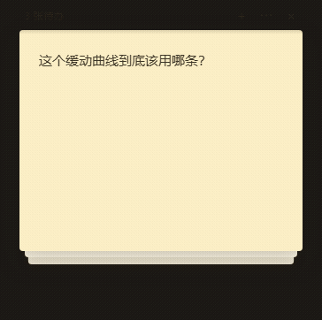

# 苍泽便签 · CZ Desktop Notes

[](https://github.com/tonghang-7/cz-desktop-notes/actions/workflows/ci.yml)



A desktop sticky note for the small stuff you would otherwise lose — a question you haven't figured out yet, a reminder you can't afford to forget.

Most note apps want you to **collect**. This one wants you to **finish**.

A single always-on-top window that shows one note at a time. Grab a corner, fold it inward — the paper folds under your cursor, and past a certain crease it tears off and the next note comes up. You can't scroll, browse, or hoard: you can only deal with the one in front of you.

- **Nothing piles up.** A dismissed note goes to an archive, not back onto the stack. Clear them all and the window says *no notes yet* — that's the goal, not a failure.
- **Fold to dismiss.** Grab the **lower** corner and drag inward — the paper folds up under your cursor, and past 42% of the card diagonal it tears off; before that it springs back flat. The upper corners are inert: pulling there does nothing at all, so the note can't be folded the wrong way or torn off by accident.
- **Summon from anywhere.** `Ctrl + Alt + Space` over any app, `Esc` to put it away.

Windows 10+ · portable zip, no installer · no account, no network, no telemetry. Everything lives in one readable JSON file at `%APPDATA%\cz-desktop-notes\data.json` — back it up, sync it, or hand-edit it.

<sub>Fold rendering uses Chromium's experimental `CanvasDrawElement`; where unavailable it silently falls back to a CSS 3D flip, so the app still works.</sub>

**Slow download?** The official link crawls in some regions. A community-run proxy mirror is ~40× faster: prefix the release URL with `https://ghfast.top/`. It is **not a GitHub service** — the server sees your request, and it could serve you a modified file, so verify the sha256 listed on the release page afterwards. It may also change domains or go down; the official link above always works.
---

## 这是什么

一款桌面便签，用来顺手记下没弄懂的问题、或者留个备忘 —— 那种不立刻写下来就会忘的小事。

大多数笔记软件希望你**积累**，这个希望你**清空**。窗口里永远只显示一张便签：捏住**下角**朝里折（往上掀），折深了就撕掉，下一张顶上来。不能滚动、不能翻列表、不能囤 —— 你只能处理眼前这一张。

## 获取

### 直接下载（Windows）

到 [Releases](https://github.com/tonghang-7/cz-desktop-notes/releases) 下载 `CZNotes-win64.zip`，**解压整个文件夹**，双击里面的 `CZNotes.exe` 运行。不需要安装。

> `CZNotes.exe` 不能单独拷出来跑 —— 它依赖同一目录下的 `icudtl.dat`、`resources\app` 等文件。

**下载慢？** 官方直连实测不到 50KB/s，146MB 要等 50 分钟以上。可以走社区的加速镜像：

[点此下载（镜像）](https://ghfast.top/https://github.com/tonghang-7/cz-desktop-notes/releases/download/v0.4.0/CZNotes-win64.zip)

或者把官方下载链接复制到 `https://ghfast.top/` 后面：

```
https://ghfast.top/https://github.com/tonghang-7/cz-desktop-notes/releases/download/v0.4.0/CZNotes-win64.zip
```

关于这个镜像，有三件事得先说清楚：

- **它不是 GitHub 提供的服务**，是社区运营的反向代理：服务端代替你去 GitHub 取文件再转发给你。
  这意味着服务端看得到你的请求（你的 IP，和你在下载哪个仓库的哪个文件）。
- **镜像里的文件理论上可以被替换**，所以下载后必须核对 sha256：

  ```sh
  certutil -hashfile CZNotes-win64.zip SHA256    # Windows
  shasum -a 256 CZNotes-win64.zip                # macOS / Linux
  ```

  校验值写在每个版本的 Release 页上（那是官方渠道）。对上了，才说明文件没被改过。

- **它随时可能换域名或者停掉**，这类服务都是这样。镜像挂了就用上面的官方地址。
  你自己挂着代理的话，直接走代理下官方地址更省事。

地址的规律是 `https://ghfast.top/` 后面接官方下载链接，换版本时替换版本号即可。

### 从源码构建

需要 Node.js：

```bash
npm install
npm run dist
```

产物在 `release/CZNotes/`，整个目录拷到任何地方都能双击 `CZNotes.exe` 运行，不需要安装。

## 用法

| 操作 | 动作 |
| --- | --- |
| `Ctrl + Alt + Space` | 呼出 / 收起便签窗 |
| 捏住便签任意位置，朝卡片内部拖 | 纸从抓取点那一角折起，折痕垂直于「抓取点 → 卡片中心」 |
| 折角没到阈值就松手 | 回弹，不摘 |
| 折过阈值（卡片对角线的 42%）松手 | 摘掉，下一张顶上来 |
| 轻点便签 | 打开管理界面 |
| `Esc` | 收起便签窗 |
| 拖顶部细条 | 移动窗口位置 |

窗口位置、卡片尺寸、所有内容都会记住。

## 管理界面

点便签上的 `⋯`，或者托盘图标双击打开。

- **新建便签**：`Ctrl + N` 或右上角按钮，新卡片排在列表最后
- **调整顺序**：直接拖动左侧列表项，越靠上越先显示
- **改内容**：右侧编辑区，输入即自动保存（停顿 0.4 秒落盘）
- **换颜色**：五个色点
- **摘掉**：列表项右侧的 ✓，或编辑器下方「完成并摘掉」
- **已完成**：底部折叠区，可以「放回」或彻底「删除」
- **卡片尺寸**：右上角「卡片尺寸」，宽 220–520、高 150–480

## 数据

`%APPDATA%\cz-desktop-notes\data.json`

纯文本 JSON，可以直接备份、手改。写盘是原子写（先写 `.tmp` 再改名），程序崩了不会写出半个文件。

想把数据放到别处（便携版、放网盘同步、几套数据轮换），设环境变量 `NOTES_DATA_DIR` 指向目录即可。

## 托盘

- 左键：呼出 / 收起
- 右键：显示便签 / 管理便签 / 打开数据文件夹 / 退出

关掉窗口不会退出程序，要退出走托盘菜单。

## 开发

```bash
npm install
npm run start      # 构建并启动
npm run build      # 只构建
npm run typecheck  # 类型检查
npm test           # 单元测试（数据格式层：版本迁移、损坏保护）
npm run dist       # 组装免安装版到 release/CZNotes/
npm run pack       # 打成 release/CZNotes-win64.zip，并打印 sha256
```

`npm run dist` 走的是 `tools/pack.mjs`：把 Electron 运行时复制一份，重命名为 `CZNotes.exe`，再把 `dist/` + `assets/` + 精简后的 `package.json` 放进 `resources/app/`。等价于 electron-builder 的 `--dir` 产物，但不依赖它。整个 `release/CZNotes/` 目录拷到任何地方都能双击运行，数据存在 `%APPDATA%`，不在程序目录。

`npm run pack` 走的是 `tools/pack-zip.mjs`：先校验关键文件齐不齐（缺 `icudtl.dat` 之类直接报错），再压缩，并**解压到干净目录做一次复现测试**。发布物必须经过它 —— 单独一个 `CZNotes.exe` 是跑不起来的。

`tools/` 下是构建脚本：`pack.mjs` 组装免安装版，`pack-zip.mjs` 打包并复现测试，`verify-dist.mjs` 校验产物完整性，`run.mjs` 启动，`gen-icon.mjs` / `gen-ico.mjs` 生成图标。

发版流程见 [`.github/RELEASING.md`](.github/RELEASING.md)。

## 几个实现上的取舍

**为什么是「折」而不是「卷」。**
卷曲需要网格顶点变形（WebGL，或逐像素重绘），而本项目默认关闭硬件加速（原因见下）。折纸用一次镜像反射就能精确表达：折痕是一条直线，折过去的那半张纸就是它关于这条线的镜像，没有任何近似。整套渲染只有两次 `drawImage`，没有接缝，耗时约等于零。

**为什么折痕方向固定指向卡片中心。**
如果折痕跟着拖动方向转，横向拖动会让折痕竖起来横扫整张卡片，一拖就折掉半边。固定朝中心后，从左下角抓就往右上折，从右下角抓就往左上折。代价是垂直于折痕方向的拖动分量不响应。

折痕推进的深度是拖动距离的 0.85 倍（`FOLD_DAMP`）。这个值刻意不是 0.5 —— 0.5 才是严格的中垂线折叠、抓取点精确贴住手指；0.85 让折角略微超过手指，观感更跟手。想更钝就往下调，调到 0.5 就是纯几何意义下的精确折纸。

**为什么只有一个窗口装所有卡片，而不是每张一个窗口。**
每张便签一个 BrowserWindow 在 Windows 上就意味着每张一个渲染进程，每张约 50MB。现在是单窗口 + 卡片绝对定位，只占一个渲染进程的量。

**为什么默认关掉硬件加速。**
这是个静态界面，翻页动画只有一张 320×250 的卡片，软件光栅化足够。而 Windows 上透明无边框窗口在硬件加速下容易出现黑边和 GPU 进程崩溃。想要 GPU 渲染可以设环境变量 `NOTES_GPU=1`，但透明窗口在部分显卡驱动上会黑边或让 GPU 进程崩掉，不保证稳定。

**为什么摘掉是两步。**
点一下就消失的设计误触率太高，而便签的全部价值就是「别忘了」。所以摘掉的卡片进归档而不是删除，随时能放回。

**为什么保存绑定卡片 id 而不是「当前选中项」。**
编辑器重建时旧 textarea 从 DOM 移除会触发 blur。如果 blur 回调去读全局的「当前选中项」，旧内容就会写进新选中的卡片。所以保存绑定卡片 id，见 `src/renderer/manager.ts` 的 `flushCurrent`。

**折叠依赖一个实验 API。**
把真卡片渲染进 canvas 用的是 Chromium 的 HTML-in-Canvas（`ctx.drawElementImage`），通过 `--enable-features=CanvasDrawElement` 开启。检测不到这个 API 时自动回落到 `rotateX` 掀纸动画，功能降级但界面不会坏。

它是实验特性。Electron 42 / Chromium 148 上直接可用；升到 Electron 45 / Chromium 156 时踩到一个新坑，
得靠「重画代号」兜住才不出错（见下面的坑三），修好后同样可用。三条结果、三个坑一并记在这里：

| 结论 | 影响 |
| --- | --- |
| `ctx.drawElementImage` 可用，需 `--enable-features=CanvasDrawElement` | 折叠方案成立的前提 |
| 伪元素 `::before` 会被画进 canvas，`mask-image` 不会 | 底部渐隐必须改用纸色渐变覆盖层，不能用遮罩 |
| 单帧 320 次 `drawImage` 约 1.8ms | 软件光栅化下够用，不需要 WebGL |

坑一：元素放进 `layoutsubtree` 后仍会在页面上自行渲染，而且忽略 `position`。要挪走它只有 `transform: translateX(-2000px)` 有效 —— `opacity: 0` 会让绘制记录消失，`visibility: hidden`、`margin-left`、`clip-path: inset(100%)` 全都画不出内容。

坑二：首次绘制完成前调用会抛 `No cached paint record for element`，必须带重试（50ms 间隔，上限 25 次）。另外别用 `requestAnimationFrame` 等待 —— 在某些上下文里它不触发。

坑三：**重画会把上一张卡连同它的折纸画布一起从 DOM 里摘掉**（`stage.innerHTML = ''`）。排在那儿等着抓图的预热任务醒来时，元素已经不在页面上了，于是抛出的是同一个 `No cached paint record` 错误 —— 但含义完全不同：不是「绘制记录还没生成」，而是「元素已经没了」。
把这种失败当成「这条路彻底走不通」，整轮折纸就被误判成不可用，之后每一次拖动都只剩掀纸动画。
所以重画时给这一轮标一个代号（`renderGen`），旧任务醒来先看自己是不是已经过期，过期就安静退出；只有用户正在拖、却怎么也抓不到，才判定折叠不可用并降级。

## 已知限制

- **仅 Windows**，多显示器与高 DPI 未适配
- 折叠依赖 Chromium 实验特性，API 若被移除会降级为 `rotateX` 掀纸
- 数据文件读不出来时会先另存一份 `data.json.corrupt-<时间>.bak` 再让你选（以空库启动 / 退出），
  原文件不会被覆盖；但如果它来自更新版本的程序，整个程序会转成只读
- 归档不会自动清理
- 无开机自启
- 打包体积 357MB、常驻内存约 280MB，是 Electron 运行时的固有成本
